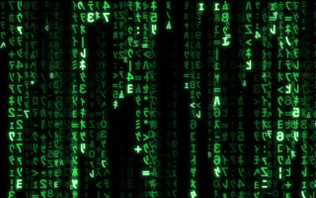

# Matrix screen saver

Digital rain for your Mac, as in the film, with an extra trick: it can rain your **real log
files**, or live logs from a **Loki** server, with error keywords picked out in red.



- Native macOS screen saver (`Matrix.saver`), written in Swift with Core Graphics. No dependencies.
- Apple silicon (M1 or later), macOS 13 or newer.
- Current version: **3.5**.

## Features

**Rain**
- Presets: Classic, Sparse, Downpour, Slow Drift. Speed, density and font size sliders.
- Colours: Classic Green, Cyan, Blue, Purple, Red, Amber, White, any custom hue, or a slow colour
  cycle.
- Characters: Film (mirrored half-width katakana and digits), Binary, Latin, your own characters,
  or Logs.

**Effects**
- Depth: three layers of rain, with distant streams smaller, dimmer and slower.
- Glow, CRT scanlines and vignette, occasional glitches.
- 15, 30 or 60 fps. Rain on every display, or the main display only.

**Text**
- A rain clock that shows the time in the rain.
- A film-style intro typed on black before the rain starts ("Wake up, {name}…").
- Hidden messages that now and then light up in a column of rain.

**Logs**
- Each stream spells out one log line as it falls. Logs characters don't flicker, streams are
  slower and trails longer, so the text can be read.
- **Log file:** any file you can read, e.g. `/var/log/install.log`. It starts at the end of the
  file and shows new lines as they're written.
- **Loki:** point it at a [Grafana Loki](https://grafana.com/oss/loki/) server, tick the
  services you want from the list Loki has, or type any LogQL query. It shows the last day of
  lines, then new ones as they arrive.
- **Keywords** such as `error, fail, denied, fatal` are shown in red (white on red rain).
- Lines are tidied for the rain: timestamps and repeated host names are removed, JSON logs become
  `level message key=value`, and logfmt noise (`ts=`, `caller=`, …) is dropped.

> Logs can contain user names, host names, IP addresses and network names. Mind who can see your
> screen.

## Install

### From a release

1. Open `Matrix-<version>.dmg` and double-click `Matrix.saver`.
2. Choose whether to install for just you or for all users.
3. In System Settings, choose **Matrix** and click **Options** to set it up.

The saver is ad-hoc signed, not notarized. If macOS blocks it, click **Done** (not Move to
Trash), then **System Settings › Privacy & Security › Open Anyway**. If it installs but won't run:

```bash
xattr -dr com.apple.quarantine ~/Library/Screen\ Savers/Matrix.saver
```

### From source

Needs the Xcode command-line tools (`swiftc`), no Xcode project.

```bash
./build.sh --install
```

That builds `build/Matrix.saver`, copies it to `~/Library/Screen Savers`, and restarts the screen
saver host so the new build loads. Reopen System Settings if it was open.

[`Instructions.txt`](Instructions.txt) is the end-user guide, with every option explained. It is
included in the DMG.

## Loki setup

Loki mode only needs Loki's HTTP API to be reachable from the Mac; there is no agent to install.

1. In Options, set **Characters** to **Logs** on the Rain tab.
2. On the Logs tab, set **Source** to **Loki server** and **Loki URL** to your server, e.g.
   `http://192.168.1.10:3100`.
3. Open **Services** and tick what you want. The list comes from Loki's `service_name` label
   over the last week, and ticking writes a query such as `{service_name=~"traefik|postgres"}`.
   You can also type any log query, e.g. `{service_name="traefik"} |= "500"`.

Notes:
- It polls `query_range` every 3 seconds while the saver is on screen, and never while it's
  hidden. All displays and previews share one connection.
- Loki logs each query it runs. So the saver doesn't rain lines about its own polls, it adds
  `!= "matrix-saver-poll" != "query_type=stats"` to every query.
- No authentication yet. Plain `http://` to a LAN IP address works.
- If the server can't be reached, the rain spells `CANNOT REACH …` and keeps retrying.

## Building and releasing

| Command | Does |
|---|---|
| `./build.sh` | Builds `build/Matrix.saver` (wipes `build/` first) |
| `./build.sh --install` | Builds and installs for the current user |
| `./build.sh --thumbnail` | Regenerates `Resources/thumbnail*.png` from a build |
| `./make-dmg.sh` | Builds `dist/Matrix-<version>.dmg` with a styled Finder window (Finder may ask to be automated) |
| `Tools/render-test.sh` | Renders the saver to a PNG without System Settings |

To release, set the version in `Info.plist`, then run `./make-dmg.sh`:

```bash
/usr/libexec/PlistBuddy -c 'Set :CFBundleShortVersionString 3.6' -c 'Set :CFBundleVersion 11' Info.plist
```

### Render test

`Tools/render-test.sh` compiles the saver with a small driver, runs it in Logs mode, and writes
`build/render-test.png`. Options are environment variables:

```bash
Tools/render-test.sh                                          # /var/log/install.log
SOURCE=/var/log/wifi.log COLOR=4 Tools/render-test.sh         # another file, red rain
SOURCE=http://192.168.1.10:3100 DURATION=12 Tools/render-test.sh
SOURCE=http://192.168.1.10:3100 SHEET=build/logs.png TAB=3 Tools/render-test.sh   # Options tab
SOURCE=http://192.168.1.10:3100 MENU=1 Tools/render-test.sh   # click through the Services menu
```

It runs outside the screen saver sandbox, so check sandbox behaviour in System Settings too.

## How it works

Everything is in [`MatrixView.swift`](MatrixView.swift):

- **Drawing:** each character is pre-rendered once, in white, into a small glowing image. A frame
  draws those images, then tints the whole frame with one multiply fill, so the colour can change
  every frame without re-rendering anything. Anything that must keep its own colour (bright
  stream heads, hidden messages, red keywords) is drawn after the tint.
- **Layers:** a grid of cells with brightness that fades per column, and falling drops that light
  cells as they pass. Depth mode stacks three layers.
- **Log feed:** reads a file's tail or polls Loki, cleans up each line, marks keyword letters, and
  hands one line to each new drop. One feed is shared per process.
- **Options sheet:** four tabs (Rain, Effects, Text, Logs), laid out with fixed frames rather than
  Auto Layout, which is fragile inside the screen saver host.

### The sandbox

Since Catalina, macOS runs third-party screen savers inside Apple's sandboxed `legacyScreenSaver`
process. Its entitlements allow read-only access to the whole disk (still subject to normal file
permissions) and outgoing network connections, which is what makes log files and Loki work.
Settings are stored with `ScreenSaverDefaults` in that process's sandbox container.

## Project layout

```
MatrixView.swift            the screen saver
Info.plist                  bundle info and version
Instructions.txt            user guide (shipped in the DMG)
build.sh                    build / install / thumbnails
make-dmg.sh                 release DMG
make-thumbnail.swift        thumbnail generator
make-dmg-background.swift   DMG window background
Artwork/, Resources/        images
Tools/render-test.sh        render test (driver in Tools/render-test/)
Archive/1.0/                source of version 1.0
CLAUDE.md                   working notes for Claude Code
```

## Version history

| Version | Changes |
|---|---|
| 3.5 | Logs fall at the same speed as Film; all rain 20% slower at every Speed setting |
| 3.4 | Logs mode falls 20% faster |
| 3.3 | Services picker for Loki |
| 3.2 | Loki as a log source; log settings on their own Logs tab |
| 3.1 | Keywords shown in red in log rain |
| 3.0 | Logs character set: rain made of a log file's lines |
| 2.2 | Presets, colours, depth, glow, CRT, glitches, rain clock, film intro, hidden messages |
| 1.0 | First version |

## Credits

By Agent Smith. A fan project inspired by the digital rain in *The Matrix*, with no connection to
the film or its makers.
